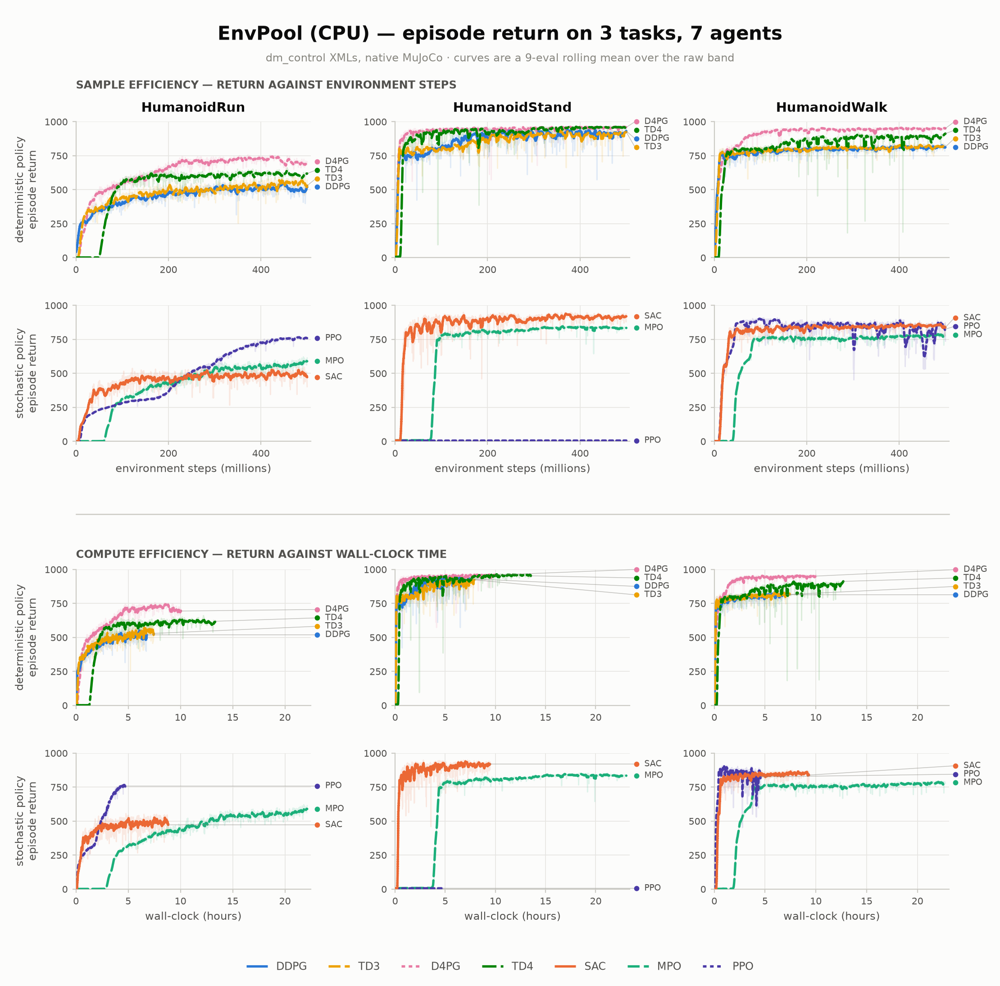
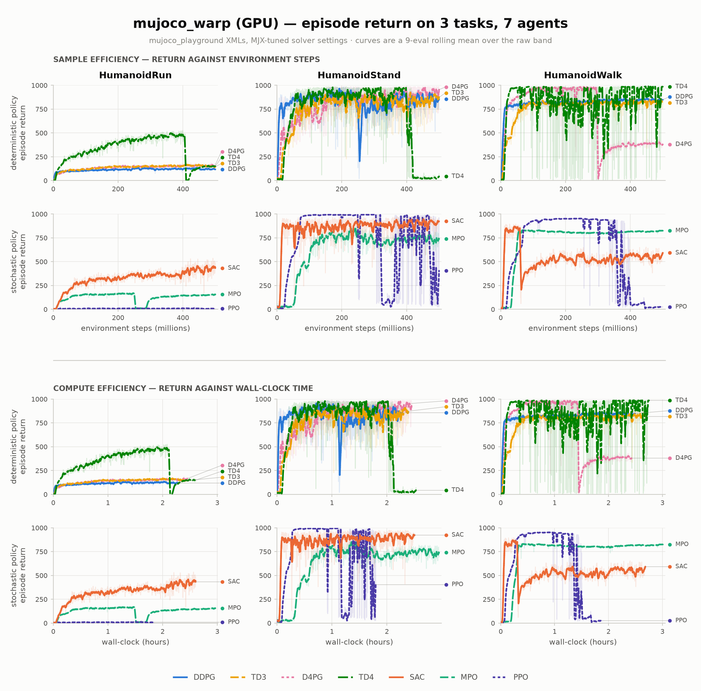
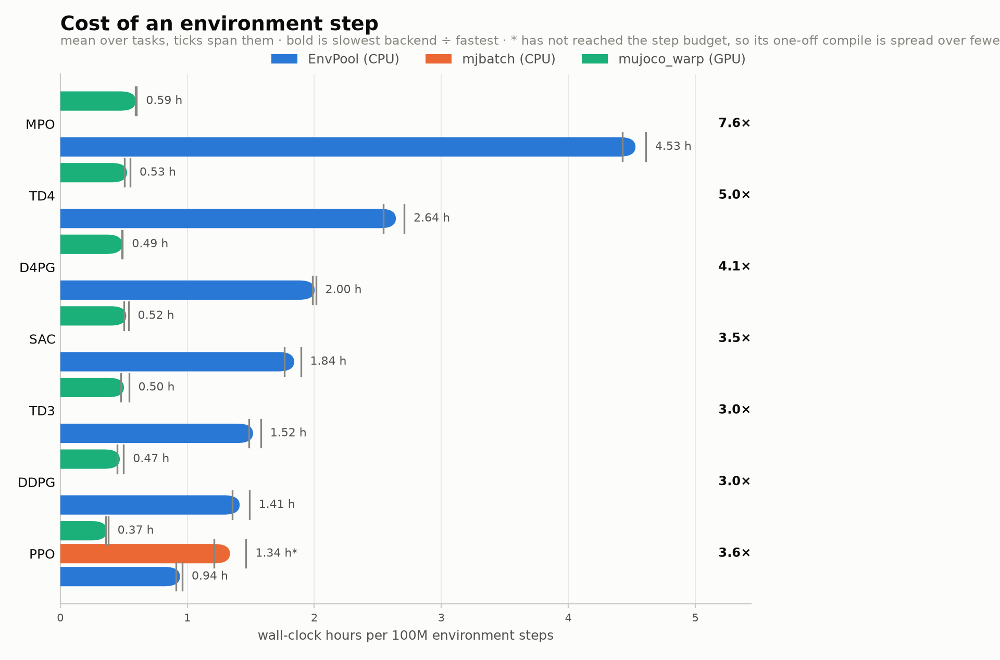

# The release benchmark

Every launchable config in this repo belongs to one grid: seven agents (DDPG, TD3, TD4,
D4PG, SAC, MPO, PPO) on `HumanoidStand`, `HumanoidWalk` and `HumanoidRun`, at matched
hyperparameters and a matched step budget. They are the hardest three tasks of the suite,
and the only ones where the agents actually separate. The grid runs them two ways:

- **Single-task** (`bench_<agent>.yaml`): each task trained on its own, on two
  implementations of the physics. **3 tasks × 7 agents × 2 cells = 42 runs**, each 500M
  env steps at 1024 parallel envs, one seed. The results below are these runs.
- **Multi-task** (`bench_<agent>.yaml` with `release/bench@bench=multitask`; d4pg has its
  own `multitask_d4pg.yaml`): one policy for all three tasks in one run, on
  Warp at 256 parallel envs. It is recorded as the task `Multitask`, so it shares the
  output tree, the W&B grouping, the plots and the export with the single-task runs. No
  released result comes from it yet.

## Results

**The figures and tables below were measured at v0.1.0, when the GPU-free cell was EnvPool
over dm_control's XMLs (`envpool_cpu`).** That cell is now `batch_cpu`, `mujoco.batch` over
the `mujoco_playground` XMLs, and has not been re-run, so they do not describe it.

Colour is the agent and so is the dash; the pale band behind each curve is the raw
evaluation, the solid line a 9-eval rolling mean. Final numbers, per task and per cell,
in [`images/release-scores.md`](../images/release-scores.md).

**`envpool_cpu` — EnvPool over dm_control's own C++ MuJoCo, no GPU anywhere in the run.**

<picture>
  <source media="(prefers-color-scheme: dark)" srcset="https://github.com/vittorione94/roxie/blob/main/images/release-dm_control-cpu-dark.png?raw=true">
  
</picture>

**`warp_gpu` — mujoco_playground over mujoco_warp.** A separate figure, and not directly
comparable: at v0.1.0 the two cells were independent reimplementations of the same tasks,
so a score gap between these figures tangles physics with algorithm.

<picture>
  <source media="(prefers-color-scheme: dark)" srcset="https://github.com/vittorione94/roxie/blob/main/images/release-playground-gpu-dark.png?raw=true">
  
</picture>

**What each backend costs.** A rate, so an arm that stopped short of the budget is still
comparable — those are marked `*`. `mjbatch` was an external
[C++ thread-pool stepper](https://github.com/kevinzakka/mjbatch), the design `mujoco.batch`
later followed, benchmarked with a separate torch learner rather than through roxie.

<picture>
  <source media="(prefers-color-scheme: dark)" srcset="https://github.com/vittorione94/roxie/blob/main/images/release-speed-dark.png?raw=true">
  
</picture>

## The cells

| Cell | Physics | Learner | In the default grid |
|---|---|---|---|
| `warp_gpu` | GPU — `mujoco_playground` + mujoco_warp | GPU | yes |
| `batch_cpu` | CPU — `mujoco_playground` + `mujoco.batch` | CPU | yes — **fully GPU-free** |
| `mjx_gpu` | GPU — `mujoco_playground` + MJX | GPU | no, one flag away |
| `mjx_cpu` | CPU — `mujoco_playground` + MJX | CPU | no, one flag away |

The two grid cells run the same task code on different physics. See
[Keeping the backends honest](backends.md#keeping-the-backends-honest).

## Running it

The runner is configured by environment, not by flags, and packs CPU runs into pinned
core slots while the GPU queue drains alongside them:

```bash
scripts/run_release_benchmark.sh                              # defaults: 3 tasks, ppo, batch_cpu
TASKS=Multitask CELLS=warp_gpu scripts/run_release_benchmark.sh  # the multi-task run
AGENTS="ddpg td3 td4 d4pg sac mpo ppo" \
CELLS="batch_cpu warp_gpu" scripts/run_release_benchmark.sh # the whole grid
CELLS=warp_gpu AGENTS=ppo TASKS=HumanoidRun scripts/run_release_benchmark.sh   # one leg
FORCE=0 scripts/run_release_benchmark.sh                      # skip finished legs
```

`FORCE=0` honours the `logs/.done` markers, which is what makes an interrupted sweep
resumable at run granularity. `CORES_PER_RUN`, `GB_PER_RUN` and the `GPU_RESERVE_*` pair
size the slots; `CORES_PER_RUN` is **logical** cores, and `batch_cpu` also gets it as
`env.num_threads` so the batch's own pool matches the pinning.
Slots are planned to stay inside one L3 domain whenever they all still fit, because a slot
crossing two domains runs far slower: TD3 measured about 15k steps/s across a domain
boundary against about 19k inside one, on a 2-die Ryzen.

Then:

```bash
uv run python roxie/report.py                        # assemble the W&B report
uv run python roxie/plot.py --grid --path outputs/release_v1 --output images/release
uv run python scripts/export_release_weights.py      # publish the policies
```

## Layout

```
experiments/release/
  bench_<agent>.yaml         single-task launchable, one per agent
  multitask_d4pg.yaml        d4pg's multi-task launchable, its replay sized for 4,096 worlds
  agent/<agent>_bench.yaml   matched hyperparameters, one per agent
  backend/<cell>.yaml        the four device cells (single-task only)
  bench/release.yaml         shared env + trainer + logging block
  bench/multitask.yaml       release.yaml plus the three-task env, on Warp
  noise/bench_gaussian.yaml  exploration noise for the deterministic arms
```

**The tasks are `mujoco_playground`'s port of the dm_control suite, not dm_control itself.** The port changes timesteps, solver settings and contacts to run well on a GPU (the package lists them in `mujoco_playground/_src/dm_control_suite/xmls/README.md`), so scores here are not directly comparable to published dm_control results.

**The single-task run's task is an override, not a file.** `release.task` is a playground registry name.

```bash
uv run python roxie/train.py --config-name release/bench_td3                 # HumanoidWalk, batch_cpu
uv run python roxie/train.py --config-name release/bench_td3 release.task=HumanoidRun
uv run python roxie/train.py --config-name release/bench_ppo release.task=HumanoidRun \
    release/backend@backend=warp_gpu
uv run python roxie/train.py --config-name release/bench_td3 \
    release/bench@bench=multitask '~release/backend@backend'                # all three, warp_gpu
```

The backend group lives in a subdirectory of the search path, so `backend=batch_cpu` is
rejected (`Key 'backend' is not in struct`) and `+backend=warp_gpu` appends a second
entry instead of replacing the default. `release/backend@backend=` is the form that works.

## Held identical across every arm

| Held fixed | Where |
|---|---|
| step budget, epoch size, eval protocol | `bench/release.yaml` |
| `parallel_envs` (1024; 256 multi-task), seed | `bench/release.yaml`, `bench/multitask.yaml` |
| actor + critic MLP `[256, 256]` | every `agent/*_bench.yaml` |
| layer norm (the six off-policy arms; PPO runs without) | every `agent/*_bench.yaml` |
| batch size, replay ratio, buffer capacity, warmup | every off-policy `agent/*_bench.yaml` |
| gamma, tau, learning rates, grad-norm clip | every `agent/*_bench.yaml` |
| n-step horizon (where the agent takes one) | every `agent/*_bench.yaml` |
| exploration noise + its anneal (deterministic arms) | `noise/bench_gaussian.yaml` |
| actor saturation penalty (deterministic arms) | every deterministic `agent/*_bench.yaml` |

Nothing is tuned per task. The one task-shaped hyperparameter is the categorical critics'
support (`v_min: -5`, `v_max: 120` in `d4pg_bench.yaml` / `td4_bench.yaml`): dm_control
rewards are normalised tolerances in [0, 1], so at gamma 0.99 the discounted return is
bounded by ~100 across the whole suite and one support covers it. A task from outside
dm_control needs it rechecked.

**Anything measured in env steps is tied to the budget** and has to move with it.
At 500M: `noise.decay_schedule.decay_steps` is 200M (40% of the budget),
`trainer.epoch_steps` 500k (1000 curve points, and the eval cadence), `trainer.save_steps`
5M (100 checkpoints for the weights export to pick a best from). `memory_warmup` and the
replay capacity deliberately do **not** scale — they are matched hyperparameters, so a
longer budget means more turnover through the same buffer.
`tests/test_release_weights.py` pins the anneal ratio and the cadence divisibility.

## What necessarily differs (algorithmic, not tuning)

| Arm | Critic | Returns | Exploration |
|---|---|---|---|
| ddpg | 1× Q | n-step 5 | gaussian noise |
| td3 | 2× Q, policy delay 2 | n-step 5 | gaussian noise |
| td4 | 2× categorical (101 atoms) | n-step 5 | gaussian noise |
| d4pg | 1× categorical (101 atoms) | n-step 5 | gaussian noise, no target smoothing |
| sac | 2× Q | **1-step** (no `n_step` in sac.py) | entropy, auto α |
| mpo | 1× Q | **1-step** (no `n_step` in mpo.py) | policy sampling + KL duals |
| ppo | V critic | GAE(0.95), on-policy | policy entropy |

Twin vs single critic is part of the algorithm, so **per-network width** is equalized, not
total parameter count.

## Where the results go

**One W&B project per env** — `roxie-HumanoidWalk` and its two siblings — with the run
identity inside a project being `<agent>.<cell>`, `job_type` the cell and `group` the grid
(`release-v1`). A project is the unit W&B gives a workspace, a run table and cross-run
charts to, so making it the env means a project's default view is already 7 agents × 2
cells on one score scale.

`roxie/report.py` assembles one W&B report with a section per task.
`roxie/plot.py --grid` reads the local `log.csv` files instead — no API round-trip — and
writes the figures above: one per (suite, device), plus the speed bars and the score
table, in light and dark for a `<picture>`. It takes several roots and merges them.

`Trainer._store_epoch_metrics` is the single place metric names are assigned, under
`train/`, `test/` and `sys/`. Two rules it enforces:

- **An absent metric is logged as absent, not as zero.** `train/loss/*` is omitted for
  epochs with no learning pass, so wandb shows a gap; a logged `0.0` is indistinguishable
  from a converged loss.
- **`sys/gpu/*` is only logged by runs actually on the GPU.** `nvidia-smi` reports the
  whole card, so a GPU-free cell would otherwise publish another process's memory and
  utilisation as its own.

## Released weights

The trained policies are published to Hugging Face at
[`vittorione/roxie-release-v1`](https://huggingface.co/vittorione/roxie-release-v1),
not committed here and not kept in the working tree: anyone who trained the grid already
has the checkpoints under `outputs/`, so a second local copy is only the upload's raw
material. The exporter stages into a temp dir, uploads, and discards it.

```bash
uv run python scripts/export_release_weights.py --dry-run      # what would ship
uv run python scripts/export_release_weights.py --dest /tmp/w  # stage, don't push
uv sync --extra hub && hf auth login
uv run python scripts/export_release_weights.py --verify       # stage + push
```

A bare run **publishes publicly** to `--hub-repo`; `--private` creates the repo private
while you check the card, and `--dest` stages without pushing at all.

It publishes one bundle per (task, cell, agent) — the whole grid, 42 policies at about
140MB — for every arm with a finished run, so a partial grid exports what it has. There
is no ledger file: it walks `outputs/release_v1/<task>/<cell>/<agent>/<stamp>/` the same
way `roxie/plot.py` does, and takes `logs/.done/<task>_<agent>_<cell>` as the record that
a run finished. Three selection rules:

- **Only marked-done runs that reached the longest budget** for their arm, resolved per
  (task, cell). A smoke pass touches the same marker, so "the newest done run" would
  publish a 100k-step policy. The budget match carries a 1% tolerance: agents step the env
  at different per-iteration increments, so one 500M budget ends at 500,000,768 for six
  agents and 500,006,912 for PPO. Pin it with `--steps`, or `--any-budget` to opt out.
- **The latest stamp** among those, which is what picks a re-run of an arm over its first
  pass.
- **The best checkpoint, not the last.** Highest `test/score` among the steps that have a
  checkpoint — but `metadata.json` and `index.tsv` also carry `test/score_final10`, the
  mean of the run's last ten evaluations. That is the number the release figures plot, and
  on an arm that peaked and then collapsed the two are far apart: `HumanoidWalk/warp_gpu`
  PPO ships a checkpoint scoring 953 out of a run that ends at 25.

The two cells run the same `mujoco_playground` task on different physics. Both give the
same observation and action width, so `checkpoint.py`'s width check cannot refuse a swap —
the cell in the bundle name is what separates them.

A bundle mirrors a run dir's shape, because `play.py` resolves its config as
`<checkpoint>/../../.hydra/config.yaml`:

```
HumanoidWalk/td3.warp_gpu/
  .hydra/config.yaml     resolved run config (play.py reads this)
  .hydra/overrides.yaml  the CLI condition the run was launched with
  checkpoints/<N>/       the orbax checkpoint
  metadata.json          score, provenance, source run, git commit
```

The Hub serves each file individually, so a user pulls one 4MB bundle rather than the
whole grid:

```python
from huggingface_hub import snapshot_download

path = snapshot_download(repo_id="vittorione/roxie-release-v1",
                         allow_patterns="HumanoidWalk/td3.warp_gpu/*")
```

```bash
uv run python roxie/play.py \
    --checkpoint-path <path>/HumanoidWalk/td3.warp_gpu/checkpoints/<N>
```

Playback forces CPU and MJX physics, so a warp-trained bundle needs neither a GPU nor a
warp install. The checkpoint carries target networks, optimizer slots and the observation
normalizer as well as the policy, so a bundle also works as a training restart:
`resume=<bundle dir>`. `--verify` reads each staged checkpoint back off disk and checks
the payload against the directory it landed in — a copy check, not a behavioural one.

The generated `README.md` carries the YAML frontmatter the Hub needs and becomes the model
card. There is deliberately no `model-index` in it: its structured results would put one
headline number per task on a public leaderboard, and on the collapsed arms that number is
the peak.

## Resuming

The trainer checkpoints every `save_steps`, and the benchmark script prints the exact
`resume=` command when a run dies with a checkpoint on disk. Resume into a *different* run
dir than the dead leg: the CSV backend opens `log.csv` with `"w"` on its first row, so
resuming in place truncates the curve the first leg wrote. The resumed leg logs total env
steps, so the two halves concatenate into one curve.
